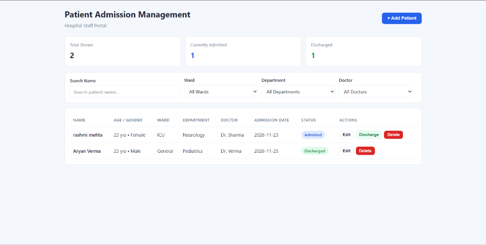
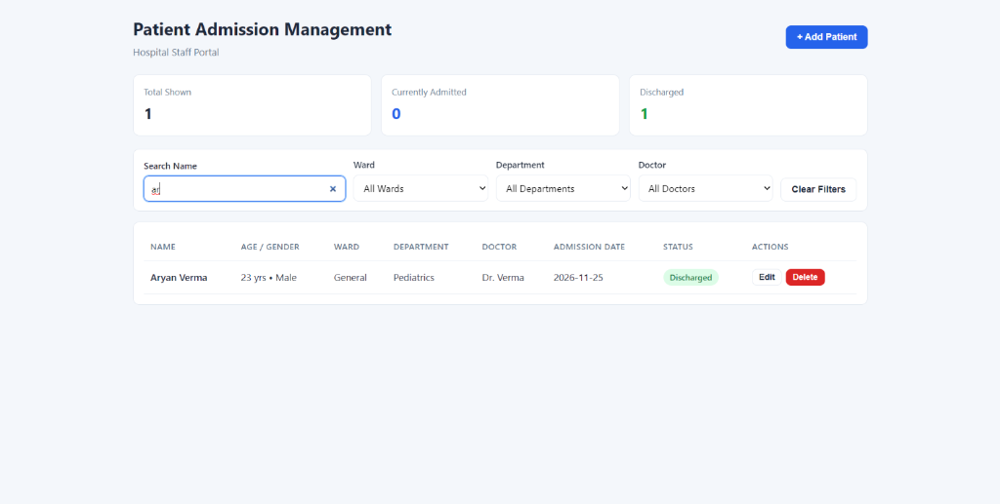
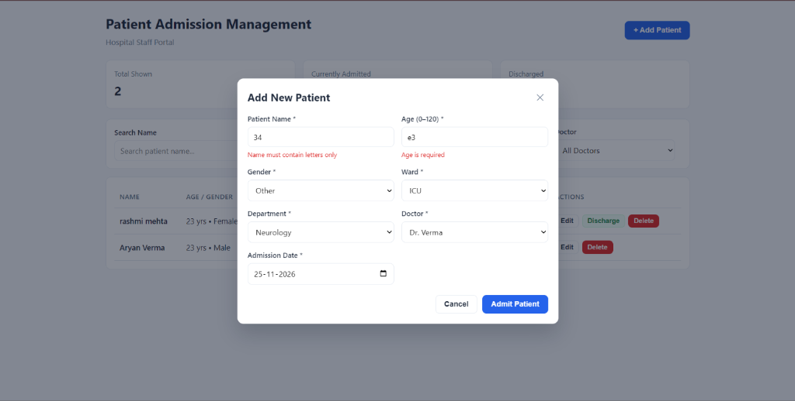

# Patient Admission Management App

A full-stack web application for hospital staff to manage admitted patients, built with **React.js**, **Python (FastAPI)**, and **PostgreSQL / SQLite**.

## Live Link

- **Live App:** `https://patient-admission-management-4mvt.onrender.com/`
- **API Docs (Swagger):** `https://patient-admission-management-backend.onrender.com/docs`

> **Note:** The backend is hosted on Render's free tier; the first request after inactivity may take ~30–50 seconds to wake up.

## Tech Stack

- **Frontend:** React.js (Vite), CSS (responsive layout for mobile, tablet, and desktop)
- **Backend:** Python 3.12, FastAPI, Pydantic v2
- **Database:** PostgreSQL (production on Render via `DATABASE_URL`) and SQLite (`backend/patients.db` locally) — data persists across server restarts

## Features

- Add a new patient with client-side and server-side validation
- View all patients (responsive table on desktop/tablet, card layout on mobile)
- Search patients by name
- Filter patients by Ward, Department, and Doctor
- Edit patient details
- Mark an admitted patient as Discharged
- Delete a patient with a confirmation dialog

## Validation Rules (Frontend & Backend)

- **Name:** Required, letters and spaces only
- **Age:** Required, whole number between `0` and `120`
- **Gender, Ward, Department, Doctor:** Required, must be selected from the allowed list
- **Admission Date:** Required, cannot be a future date

## Steps to Run Locally

### 1. Start the Backend (FastAPI)

```bash
cd backend
python -m venv .venv
# Windows PowerShell:
.venv\Scripts\Activate.ps1
# macOS/Linux:
# source .venv/bin/activate

pip install -r requirements.txt
cd ..
uvicorn backend.main:app --reload --port 8000
```

Backend runs at `http://127.0.0.1:8000`.

### 2. Start the Frontend (React + Vite)

```bash
cd frontend
npm install
npm run dev
```

Frontend runs at `http://localhost:5173`.

> Optional: Set `VITE_API_URL` in `frontend/.env` if your backend runs on a different URL.

## Screenshots

### Dashboard & Patient List


### Search & Filter


### Add Patient & Validation

